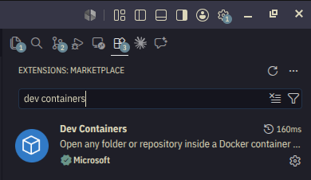

## TP 1 : Découverte du robot

### Objectifs

- Identifier les composants et vérifier le câblage.
- Compiler et charger un programme sur la carte.
- Piloter le robot par le câble USB.
- Ajouter une commande au programme.

### Matériel

- [ ] Raspberry Pi Pico WH
- [ ] Shield Grove
- [ ] Carte moteur L298N
- [ ] 4x moteurs à courant continu
- [ ] Télémètre à ultrasons Grove
- [ ] Télémètre à infrarouges VL53L1X
- [ ] Afficheur 16x2 Grove
- [ ] 2x batteries (une pour les moteurs, une pour le Pico via un abaisseur de tension)
- [ ] Câble micro-USB

Le schéma de câblage est dans `schematics/sketches/Robot_Schema_completed.fzz`.

> ⚠️ Vous êtes responsables de l'inventaire de vos boîtes ! Il sera vérifié en fin de cycle.
> Merci de signaler aux enseignants tout matériel cassé ou perdu afin de le remplacer.

### Mise en place

- On travaille avec une machine sous **Linux** :
  - ⚙️ Démarrer sous Debian sur les machines du département
- On utilise l'environnement de développement [**Visual Studio Code**](https://code.visualstudio.com/) :
  - ✅ Disponible sur les machines du département
  - Installer l'extension pour VS Code : "*Dev Containers*"

    
- On télécharge l'archive du projet depuis Moodle et on la décompresse :

  ```sh
  unzip rubo-smol.zip
  ```

- On initialise l'environnement logiciel. Ces étapes devront être réalisées **à chaque TP** :

    - On utilisera un conteneur de développement. Sur les machines du département, il faut exécuter une première fois la commande `docker` pour initialiser le *daemon* :

      ```sh
      docker
      ```

    - Ouvrir le projet dans VS Code :
    
      ```sh
      code rubo-smol/
      ```

    - Rouvrir le projet dans le conteneur (<kbd>Ctrl</kbd> + <kbd>P</kbd> > "*Reopen in Container*")

### Déroulé

1. Ouvrir `robot/Config.h`. Le schéma de câblage est en tête de fichier. Vérifier chaque fil sur le robot avant de brancher l'alimentation.

2. Dans le conteneur, compiler le firmware (le compilateur et le SDK sont déjà installés) :

   ```sh
   python3 tools/build.py
   ```

3. Brancher la carte en USB, et vérifier qu'elle est bien reconnue :

   ```sh
   python3 tools/pico.py list
   ```

   Puis charger le programme. Enclencher `BOOTSEL` n'est normalement pas nécessaire :

   ```sh
   python3 tools/build.py --flash
   ```

4. Ouvrir la console :

   ```sh
   python3 tools/pico.py console
   ```

   Quitter par <kbd>Ctrl</kbd> + <kbd>A</kbd> puis <kbd>Ctrl</kbd> + <kbd>X</kbd>. Relever la liste des périphériques détectés au démarrage. Un capteur marqué `ENABLED BUT NOT RESPONDING` signale un problème de câblage.

5. Tester les moteurs en tapant les commandes dans la console :

   ```json
   {"left": 200, "right": 200}
   {"left": 200, "right": -200}
   {"left": 0, "right": 200}
   ```

   Si un moteur tourne à l'envers, inverser la valeur de `LEFT_MOTOR_REVERSED` ou de `RIGHT_MOTOR_REVERSED` dans `Config.h`, puis recompiler et recharger.
   Si le robot recule au lieu d'avancer, inverser les deux ne suffit pas : il faut aussi échanger les broches du moteur gauche et du moteur droit, sinon les virages sont inversés.

6. Relever la vitesse minimale à laquelle chaque moteur démarre. En dessous, le moteur bourdonne sans tourner.

7. Approcher la main du capteur et suivre la valeur `front_mm` dans la télémétrie. N'utiliser cette distance que si `front_ok` est vrai ; sinon `front_mm` vaut `-1`.

8. Lire la fonction `enforceSafety()` dans `robot/Robot.h` et les constantes `DEFAULT_DURATION_MS` et `MAX_DURATION_MS` dans `Config.h`.

9. Écrire la mission 1, arrêt devant un obstacle.
    - Lire d'abord `Robot::update()` dans `robot/Robot.h` : à chaque tour, il actualise les capteurs, lit les commandes, puis appelle `mission()`.
    - `{"mission":1}` ne fait pas avancer le robot ! La mission arrête seulement un mouvement en cours en cas d'obstacle.
   - Dans `Robot.h`, remplacer `MISSION_NAMES = ""` par `MISSION_NAMES = "obstacle"`.
   - Dans le `switch` de `mission()`, ajouter `case 1: stopAtObstacle(); break;` après `case 0`.
   - Toujours **dans la classe `Robot`**, près de `mission()`, commencer la méthode suivante :

     ```cpp
     void stopAtObstacle() {
       if (!front.valid()) return; // ne pas utiliser une mesure absente
       // À compléter : si front.distanceMm() n'est pas sous 150 mm, retourner.
       // À compléter : si aucune roue n'avance, retourner.
       // À compléter : arrêter le mouvement et signaler sa fin.
     }
     ```

      - `front.distanceMm()` donne la distance en millimètres.
      - `motors.left()` et `motors.right()` donnent des vitesses signées (positive = marche avant).
      - Pour la dernière ligne, chercher comment `enforceSafety()` arrête les roues, désarme `_hasDeadline` et envoie une télémétrie `done`.
      - On utilise `drive()` pour **démarrer** un mouvement avec une échéance ; ici on veut arrêter celui qui est en cours. La méthode doit retourner tout de suite, sans boucle d'attente.
   
   - Compiler avec `python3 tools/build.py` ; corriger les erreurs avant de charger avec `python3 tools/build.py --flash`. Poser d'abord le robot sur un support, roues en l'air. Dans la console, envoyer :

      ```json
      {"mission": 1}
      {"left": 200, "right": 200, "duration": 3000}
      ```

    - Approcher une main du capteur avant à moins de 150 mm : les roues doivent s'arrêter **avant** les trois secondes, et une ligne de télémétrie doit contenir `"done":true` et `"moving":false` (cette mission envoie elle-même la ligne `done` quand elle arrête les roues).
    - Avec la main toujours proche, essayer `{"left":-150,"right":-150}` : la marche arrière doit rester
     possible.
    - `{"mission":0}` désactive la mission ; `{"stop":true}` arrête aussi le robot et la désactive, mais n'envoie pas de ligne `done`.
